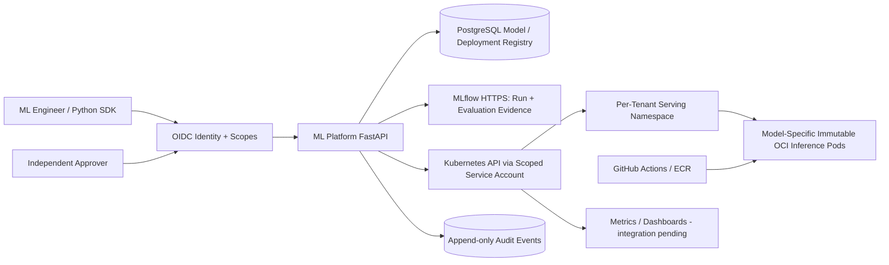

# LSK ML Deployment Platform

**Purpose:** A reusable internal platform through which ML engineers register, review, deploy, version, monitor and roll back model inference services on Kubernetes without writing Kubernetes deployment YAML. The aerospace inspection classifier is an **example workload**, not the platform.

**Project status:** independent portfolio simulation, synthetic data only. Source, policy tests and AWS infrastructure/deployment templates are in this repository; real AWS provisioning, MLflow/Ray installations, live integration tests, Kubernetes reconciliation and SRE handover are **not verified**. No proprietary, export-controlled or real aerospace customer data is included.

## CTO mandate

Provide ML and Quality engineering teams with a governed path from experiment to model serving. Enforce traceable MLflow experiment lineage, evaluation thresholds, separate model approvers, per-team namespaces and immutable image digests. Use AWS EKS as the initial supported runtime with hybrid/on-prem Kubernetes as a future controlled expansion. Human aerospace quality dispositions stay in their authoritative QMS, never inside the deployment platform.

## Architecture



**Control plane:** `mlplatform/` provides registration, MLflow evaluation verification, approval, deployment revision/audit storage, Kubernetes resource reconciliation and rollback API.

**Data plane:** customer-approved immutable ECR images implementing `GET /healthz`, `GET /readyz`, `POST /predict` on port 8080. A sample model image lives at `examples/sklearn_inference/`. Platform does not assume a particular ML algorithm.

**Demonstration workload:** `app/` is a separate aerospace inspection triage simulator with human reviewer endpoints, not general ML platform logic.

## ML engineer end-to-end deployment

1. Train and evaluate a model; log a completed MLflow run with `validation_auc`, `dataset_sha256`, `git_sha`, `tenant_id`, `evaluation_ref`. Publish its artifact as `runs:/<run_id>/model`.
2. Build an inference image implementing the HTTP contract and publish to the organization's approved ECR repository. Obtain immutable `@sha256:` digest.
3. Use `sdk/platform_client.py` to **register** the model with the model image digest, MLflow run ID and evaluation reference. Platform checks a live authenticated MLflow API.
4. Another engineer, carrying `ml:approve`, **approves** the record. Self-approval is blocked in PostgreSQL transactions.
5. Engineer carrying `ml:deploy` calls `deploy_model` with model ID, name, environment and replica count. Platform derives tenant from signed OIDC claim and namespace from a server-controlled allowlist.
6. Kubernetes creates or updates tenant-specific Deployment/Service; PostgreSQL records an immutable revision. **Submitted does not imply ready or healthy**. A separate actual rollout/monitoring validation is required.
7. Platform users inspect revision history or request a scoped rollback. SREs validate service health, operational telemetry and DR before cutover.

## Repository layout

| Directory | Responsibility |
|---|---|
| `mlplatform/` | Actual reusable model deployment API, policies and controller |
| `sdk/platform_client.py` | ML engineer SDK with register/approve/deploy/status/history/rollback |
| `production/db/002_platform_control_plane.sql` | PostgreSQL model approvals, deployment revisions and audit |
| `production/k8s/ml-platform-api.yaml` | Control-plane deployment and ClusterIP service |
| `production/scripts/render_tenant_bootstrap.py` | Reviewed tenant namespace, RBAC and model-serving SA generation |
| `production/terraform/` | Private AWS EKS/VPC/ECR/S3/Multi-AZ RDS target infrastructure |
| `examples/sklearn_inference/` | Reusable `/predict` inference-container contract example |
| `app/`, `ml/` | Synthetic aerospace inspection demonstration |
| `pilot/` | MLflow/Ray pilot scaffolds; no claim they are operational |
| `docs/enterprise/` | Requirements, CTO backlog, phase gates, risk and handover |

## ML platform deployment

Read [deployment architecture and user workflow](docs/ML_PLATFORM_DEPLOYMENT.md) and [AWS infrastructure runbook](production/terraform/DEPLOY.md). One-time tenant namespaces/RBAC need a dedicated cluster bootstrap administrator. Production API needs OIDC, MLflow, PostgreSQL and Kubernetes API access. Repository workflows only deploy after explicit environment approval and credentials are connected.

Local source checks:
```bash
python -m pip install -r requirements.txt
python -m pytest -q
docker build -f mlplatform/Dockerfile -t lsk-mlplatform-api:local .
docker build -f examples/sklearn_inference/Dockerfile -t lsk-inference-example:local .
```
`mlplatform` is **not** intentionally configured to bypass OIDC for local experiments. Tests mock external systems; source checks do not prove cloud readiness.

## Phase scope and honest readiness

**Implemented as code:** FastAPI APIs, typed model registration, MLflow evidence lookup, approval separation, tenant mapping, immutable ECR image validation, PostgreSQL registry/audit schema, revision API, Kubernetes resource generation/reconciliation, Python SDK and CI.

**Not validated end-to-end:** identity provider integration, actual MLflow tracking service, PostgreSQL migration, private EKS workload launch, model image provenance/signing, per-tenant network isolation, live drift and SLO monitoring, automated progressive rollout, GPU/Ray jobs, cluster failure recovery, data classification, signed handover. See [project production status](docs/PRODUCTION_DEPLOYMENT_STATUS.md).

This public project is an engineering demonstration, **not evidence that an employer ran the architecture in production**.
