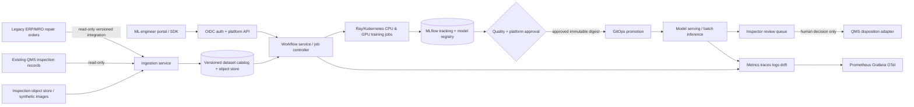

# Enterprise reference architecture

## Context and trust boundaries

The simulated POC implements only the legacy API, synthetic feature dataset, local training/inference and inspector review. Other nodes are phase targets; see branch plans.

## Platform planes
- **Experience plane:** Python SDK, self-service API, templates, documentation, quotas, error catalog.
- **Control plane:** OIDC/JWT, project tenancy, dataset and run metadata, model promotion policy, job admission, audit events.
- **Data plane:** isolated Kubernetes namespaces, training workers with CPU/GPU node pools, object store and registry, autoscaled model serving.
- **Operations plane:** telemetry, FinOps cost attribution, backup/DR, alerting and runbooks.

## AWS and on-prem target
AWS landing zone per environment: multi-account dev/staging/prod, private EKS nodes across 3 AZs, S3 with KMS and versioning, RDS PostgreSQL, ECR, IAM Roles for Service Accounts/Pod Identity, Secrets Manager, private endpoints, ALB/WAF only at controlled ingress. Separate GPU node pool with taints, quotas and scaling; no untrusted training workloads on control-plane nodes. On-prem Kubernetes uses internal S3-compatible storage and a protected registry, private connectivity, independent auth trust and an explicit data-residency policy. Jobs are scheduled **where datasets are permitted**, not indiscriminately mirrored.

## Critical paths
Dataset manifest (source + digest + schema + labels + split seed) → training image digest + config + code revision → experiment ID → evaluation report → approved model digest → signed deployment revision → prediction record → inspector approval and audit log. Fail closed at each missing authority.

## Failure and safety
Inference unavailable → use manual inspection; no system may release a part on a prediction alone. Retraining outage → keep approved previous version. Unknown data schema → quarantine. Registry offline → block new promotion, keep running pinned serving artifact. Drift alert → human review before retraining or redeployment.

## Architecture validation
Verify threat model, L4/L7 flows, IAM diagram, storage classification, RPO/RTO tests, GPU scheduling/cost evidence, isolation, migration plan, failure injection and rollback. The public repo illustrates patterns only and contains no actual enterprise deployment.
