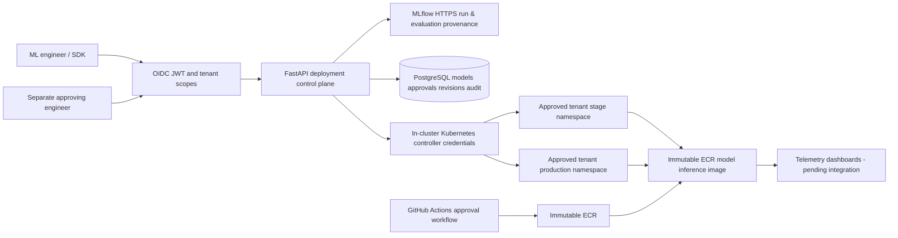

# LSK ML Deployment Platform — architecture and trust boundaries

## Implemented interfaces (feature branch)
- OIDC-scoped register, approve, deploy, status, history and rollback APIs.
- Signed JWT-derived tenant identity; no namespace accepted in request.
- MLflow API verifies finished run, evaluation metric, tenant, dataset/code lineage and exact registered image digest.
- A distinct approver records approval; deployment requires prior approval.
- PostgreSQL records model/version/revision and audit; Kubernetes accepts desired state in namespace-only RBAC.
- Model images must implement `/healthz`, `/readyz` and `/predict` on 8080. The example classifier satisfies the contract.

## Trust and security gaps
- Kubernetes API rollout submission is **not** proof of healthy serving traffic.
- IAM principal access, model image signature verification, database RLS, tamper-proof audit sink, canary, reconciliation queue and full Kubernetes policy enforcement remain pending.
- Multi-AZ infrastructure and RDS configuration are targets until actually applied.
- MLflow and Ray/GPU workloads require secure installation and separate operator access.
- No automated aerospace repair disposition is permitted. Example uses synthetic records only.

## Architecture decision
Separate **model deployment control plane** from **model inference data plane** and from **domain-specific sample apps**. Allow only immutable OCI images whose MLflow run metadata and approval are verified. Namespaces and policies are provisioned by a privileged, separately-reviewed bootstrap workflow, never by untrusted ML platform users.
